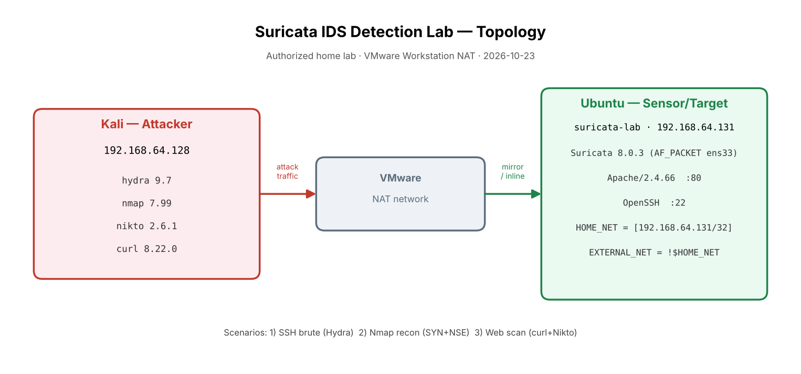
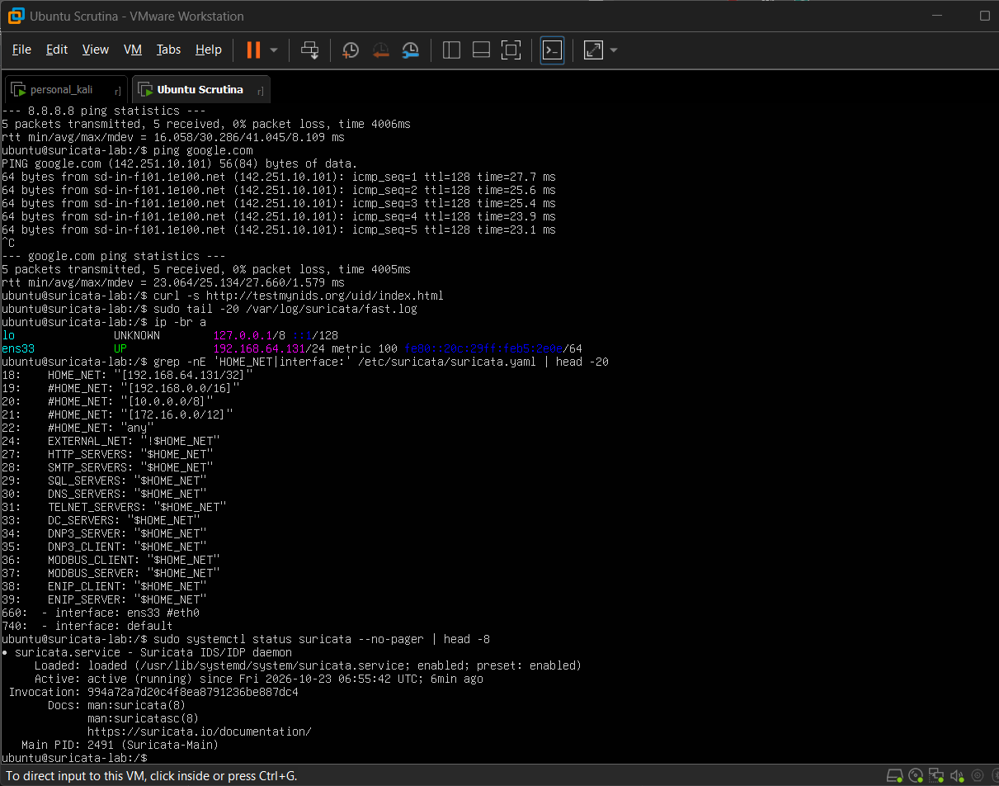
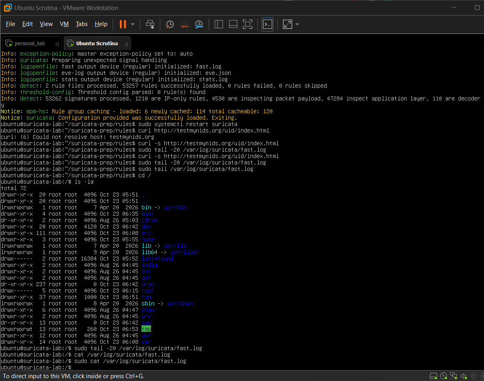
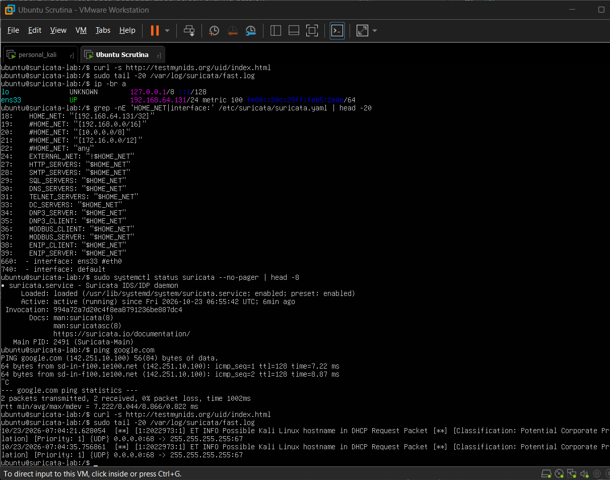
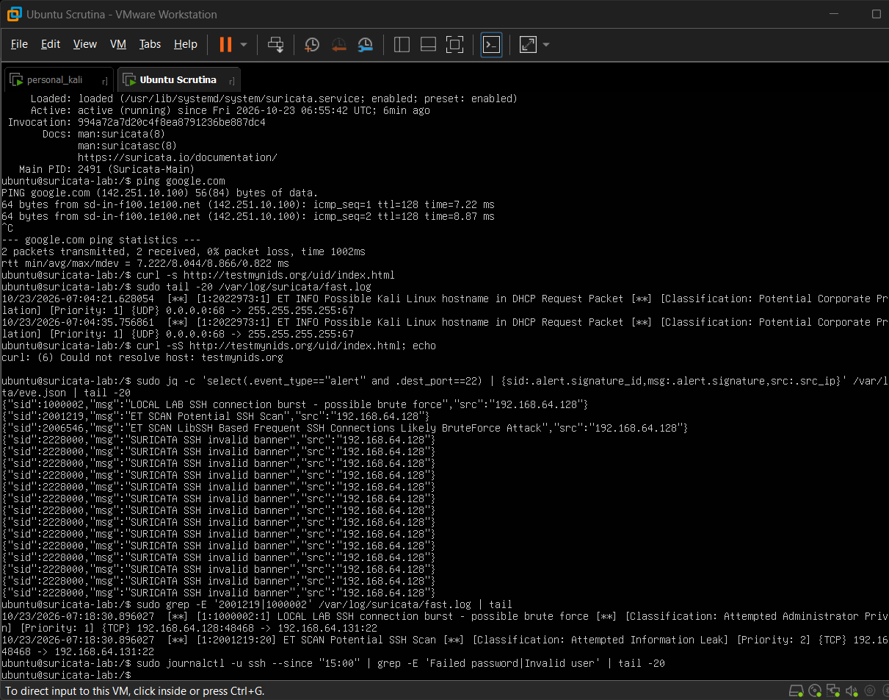
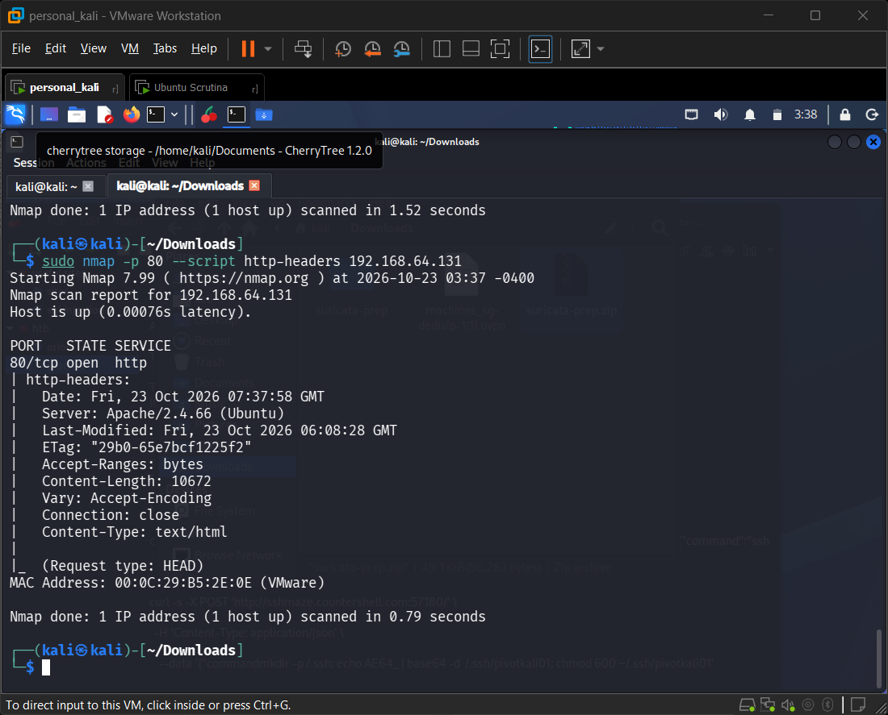
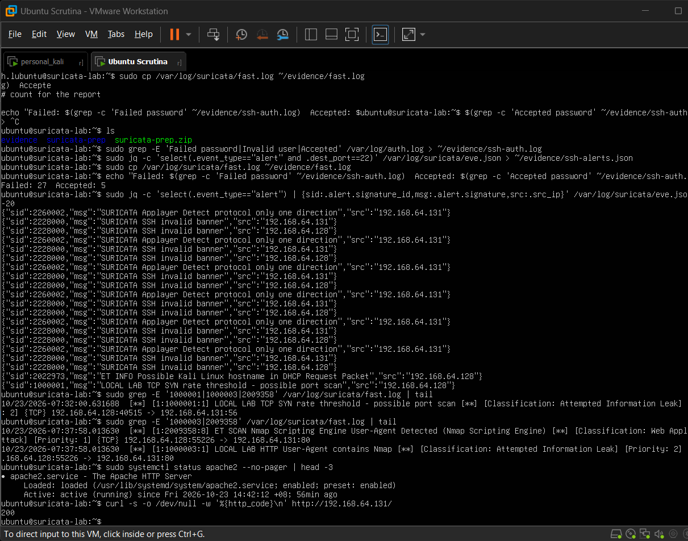
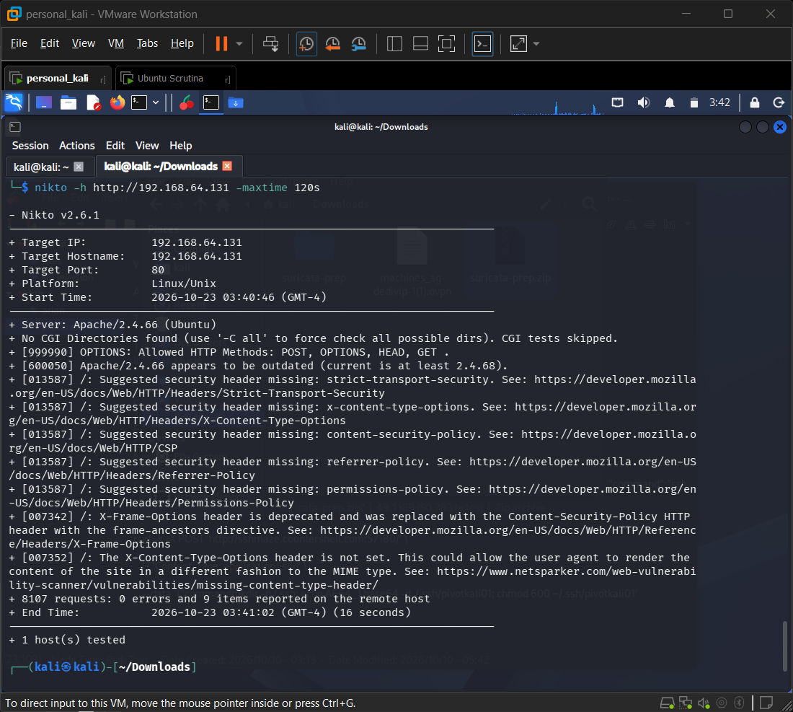
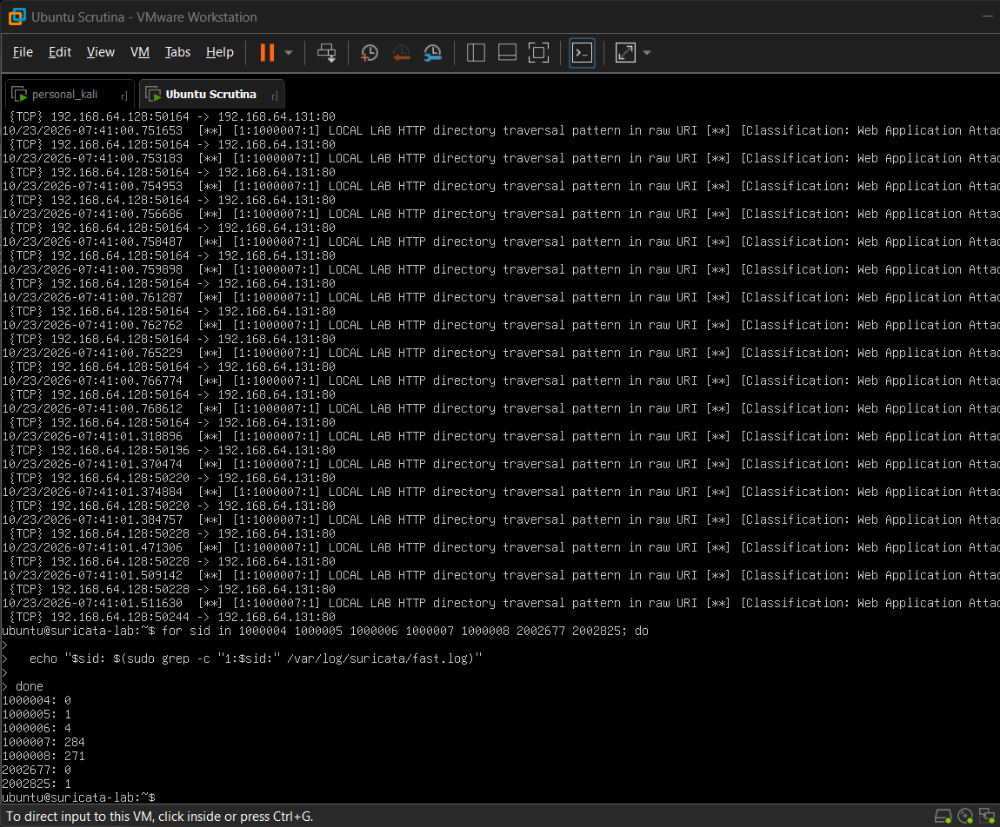
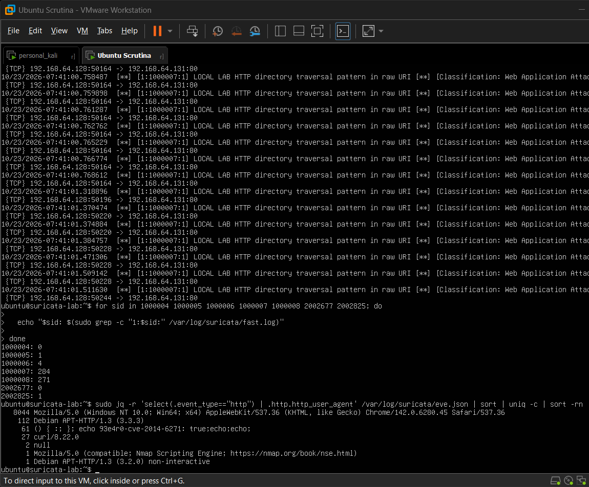

# Incident Report — Suricata Detection Lab

> **Authorized home lab.** All activity described here was performed by Jove Teo
> against his own virtual machines on his own laptop, with no external targets and
> no production systems involved. Structure follows NIST SP 800-61r3-shaped
> 13-section layout. Scenario 1 (SSH brute force) is complete with real captured
> data; Scenarios 2 (Nmap recon) and 3 (web scan) are also complete with real
> captured data. Timestamps (SGT), tool versions, SHA-256 hashes, ET-ruleset date,
> Suricata version (**8.0.3**), and the 12 terminal screenshots are now filled.
> captured. This report describes a training lab and does **not** claim production SOC detection capability.

---

## Screenshots needed

Capture each of these and drop the file at the indicated path (all under
`evidence/screenshots/`). Each matching placeholder appears inline later in the
report.

- [x] `evidence/screenshots/00-lab-topology.png` _(generated diagram)_ — Lab overview: VMware Workstation showing the Kali VM (`192.168.64.128`) and Ubuntu sensor VM (`suricata-lab`, `192.168.64.131`) on the NAT network. A simple hand-drawn/Visio topology diagram is also fine.
- [x] `evidence/screenshots/00b-suricata-ruleset-stats.png` _(source: Screenshot 2026-10-23 145832.png (suricata -T: 53257 loaded, 0 failed) + 145407 (suricata-update 8.0.3, 53249 enabled))_ — Ubuntu: `sudo suricatasc -c ruleset-stats` output showing ~53257 rules loaded, 0 failed (sensor healthy).
- [x] `evidence/screenshots/00c-suricata-yaml-homenet.png` _(source: Screenshot 2026-10-23 150229.png)_ — Ubuntu: `suricata.yaml` snippet showing `HOME_NET: "[192.168.64.131/32]"`, `EXTERNAL_NET: "!$HOME_NET"`, and the `af-packet` block on `ens33` (cluster_flow, tpacket-v3).
- [x] `evidence/screenshots/00d-sensor-live-dhcp.png` _(source: Screenshot 2026-10-23 151243.png)_ — Ubuntu: `fast.log`/`eve.json` showing the **ET INFO Kali hostname in DHCP Request** alert — proof the sensor was live on `ens33` (used in place of the skipped testmynids baseline).
- [x] `evidence/screenshots/01-ssh-eve-alerts.png` _(source: Screenshot 2026-10-23 152059.png)_ — Ubuntu: jq summary of Scenario 1 `eve.json` alerts (dest_port 22) showing SIDs **1000002**, **2001219**, **2006546** firing from `192.168.64.128`.
- [x] `evidence/screenshots/01b-ssh-authlog-accepted.png` _(source: Screenshot 2026-10-23 152747.png + 153050 (Failed:27 Accepted:5))_ — Ubuntu: `/var/log/auth.log` showing many `Failed password` / `Invalid user` lines ending in `Accepted password for ubuntu from 192.168.64.128`.
- [x] `evidence/screenshots/01c-hydra-run.png` _(source: Screenshot 2026-10-23 152416.png (success ubuntu:ubuntu) + 151916 (failed -t4))_ — Kali: the successful `hydra ... -t 1 -W 2 -f ssh://192.168.64.131` run showing the cracked `ubuntu` credential.
- [x] `evidence/screenshots/01d-ssh-invalid-banner-noise.png` _(source: Screenshot 2026-10-23 152534.png)_ — Ubuntu: the burst of SID **2228000** `SURICATA SSH invalid banner` entries (observed noise from Hydra's reset handshakes).
- [x] `evidence/screenshots/02-nmap-run.png` _(source: Screenshot 2026-10-23 153852.png)_ — Kali: the `nmap -sS -p 1-200` and `nmap --script http-headers` runs.
- [x] `evidence/screenshots/02b-nmap-alerts.png` _(source: Screenshot 2026-10-23 153943.png + 153516)_ — Ubuntu: `fast.log`/`eve.json` showing **1000001** (SYN rate), **1000003** + ET **2009358** (Nmap UA).
- [x] `evidence/screenshots/03-webscan-run.png` _(source: Screenshot 2026-10-23 154228.png)_ — Kali: the curl loop + Nikto 2.6.1 run (8107 requests).
- [x] `evidence/screenshots/03b-webscan-alerts.png` _(source: Screenshot 2026-10-23 154325.png)_ — Ubuntu: SID hit counts — **1000005=1**, **1000006=4**, **1000007=284**, **1000008=271**, **2002825=1**, and **1000004=0 / 2002677=0** (UA miss).
- [x] `evidence/screenshots/03c-http-user-agents.png` _(source: Screenshot 2026-10-23 154442.png)_ — Ubuntu: `jq` of unique `http.http_user_agent` values showing Nikto 2.6.1 spoofing a Chrome Windows UA (~8044 hits) and no literal "Nikto" string.

---

## 1. Metadata

| Field | Value |
|-------|-------|
| Title | Multi-Scenario Attack Detection against Lab Ubuntu Host (SSH Brute Force / Nmap Recon / Web Scan) |
| Date of activity | 2026-10-23 (Asia/Singapore) |
| Report authored | 2026-10-23 (Asia/Singapore) |
| Analyst | Jove Teo |
| Sensor | Suricata **8.0.3** on Ubuntu 26.04.1 LTS (kernel `7.0.0-38-generic`) lab VM (`suricata-lab`, `192.168.64.131`) |
| Attacker | Kali lab VM `192.168.64.128` (hydra 9.7, nmap 7.99, nikto 2.6.1, curl 8.22.0) |
| Scope / network | HOME_NET=`[192.168.64.131/32]` (victim /32); EXTERNAL_NET=`!$HOME_NET`; IFACE=`ens33` |
| Virtualization | VMware Workstation, NAT network |
| Classification | Training / authorized controlled exercise — no production impact |
| Related scenarios | Scenario 1 SSH (complete) · Scenario 2 Nmap (complete) · Scenario 3 Web (complete) |
| Report status | Draft |

---

## 2. Executive Summary

Between **15:18:30 SGT** and **≈15:53 SGT** (Asia/Singapore), Suricata on host
**`suricata-lab`** (`192.168.64.131`) detected authorized lab traffic from the Kali attacker
VM **`192.168.64.128`**.

**Scenario 1 — SSH brute force (COMPLETE):**

- Technique: Hydra password-guessing against OpenSSH on `192.168.64.131:22`.
- Signatures that fired: **3 signatures** — local **1000002** (`LOCAL LAB SSH connection burst`),
  ET **2001219** (`ET SCAN Potential SSH Scan`), and ET **2006546**
  (`ET SCAN LibSSH Based Frequent SSH Connections Likely BruteForce Attack`).
- Outcome: **the brute force succeeded** — the `ubuntu` account was cracked
  (host log: `Accepted password for ubuntu from 192.168.64.128`).
- Correlation: Suricata detected the **connection burst** but cannot see passwords;
  `/var/log/auth.log` provided the proof of **password guessing and successful login**.
- Observed noise: a burst of SID **2228000** (`SURICATA SSH invalid banner`) — a stream/anomaly
  side-effect of Hydra's aborted/reset handshakes, **not a real detection**.

**Scenario 2 — Nmap recon (COMPLETE):**
- `nmap -sS -p 1-200` fired local **1000001** (TCP SYN rate) and **no ET SID** — confirms the intended detection gap (classic ET Nmap SYN SIDs are commented out upstream; local rule fills it).
- `nmap -p 80 --script http-headers` fired local **1000003** + ET **2009358** (Nmap Scripting Engine User-Agent).
- Observed noise: SID **2260002** (applayer one-direction) and residual **2228000** from half-open SYN scanning — benign artifacts, not detections.

**Scenario 3 — Web scan (COMPLETE):**
- Hit counts from `fast.log`: **1000005**=1 (curl UA), **1000006**=4 (GET burst), **1000007**=284 (directory-traversal pattern), **1000008**=271 (script-tag-in-URI pattern), ET **2002825**=1 (curl).
- **UA miss:** local **1000004**=0 and ET **2002677**=0. Root cause: Nikto 2.6.1 spoofed a Chrome-on-Windows User-Agent (~8044 HTTP events) and never sent a UA containing the literal string `Nikto`. Payload/behavior rules still caught the scan.
- Nikto 2.6.1 ran 8107 requests against Apache/2.4.66; reported missing security headers and an outdated Apache build.

- Detection rate (Scenario 1 positive tests): **1/1 runs detected**
- Negative controls: **2 runs** (single SSH login, single Mozilla curl) — **no false positives** on any scan/brute SID
- Gaps / caveats: network signatures count connection bursts, not passwords; the testmynids
  baseline was skipped (site down today); pure `-sS` produces no ET alert (local 1000001 fills the gap);
  Nikto UA SIDs missed because Nikto 2.6.1 spoofs Chrome.

All activity was authorized. No production systems were involved.

---

## 3. Scope and Environment

| Item | Value |
|------|-------|
| Topology | Kali `192.168.64.128` → VMware NAT → Ubuntu + Suricata `192.168.64.131` (`suricata-lab`) |
| Capture | AF_PACKET on `ens33`; `cluster-type: cluster_flow`; `tpacket-v3: yes` |
| HOME_NET | `[192.168.64.131/32]` (victim /32, so Kali is EXTERNAL) |
| EXTERNAL_NET | `!$HOME_NET` |
| Ruleset | ET Open (via `suricata-update`, ruleset dated 2026-10-23; **53249 ET enabled**) + `rules/local.rules` (SIDs 1000001–1000008); **53257 rules loaded, 0 failed, 0 skipped** (`suricata -T` PASS) |
| Host OS | Ubuntu 26.04.1 LTS, kernel `7.0.0-38-generic` (OpenSSH uses **socket activation**; per-connection logs tagged `sshd-session`, auth lines in `/var/log/auth.log`) |
| Host services | OpenSSH on :22; Apache/2.4.66 on :80 |
| Offloads | `ethtool -k ens33`: **GRO off, LRO off [fixed], rx-checksumming off** (GRO/LRO disabled at setup via `ethtool -K ens33 gro off lro off`); Suricata af-packet **`checksum-checks: auto`** (stream `checksum-validation: yes`) |
| Clock caveat | VM clock was on **UTC** during the Scenario 1 run (stamps ~07:18–07:27 UTC); recommend `sudo timedatectl set-timezone Asia/Singapore` for future runs |
| Lab authorization | Own VMs on own laptop; no external targets |







**Sensor liveness (baseline note).** The usual `testmynids.org` regression check was
**SKIPPED today** because the site was down / mis-resolving (it resolved to `198.18.0.1`
and the connection timed out). This is a **limitation of the external test site, not a sensor
fault.** The sensor was instead proven live by capturing **ET INFO Kali-hostname DHCP Request**
alerts on `ens33`, confirming Suricata was reading traffic on the correct interface.



---

## 4. Detection

### Scenario 1 — SSH brute force (real data)

| Signal | Source | First seen (SGT) | SID / message |
|--------|--------|------------------|---------------|
| Primary alert | Suricata `eve.json` / `fast.log` | 15:18:30 SGT | **1000002** — `LOCAL LAB SSH connection burst - possible brute force` |
| Supporting alert | Suricata | ≈15:18–15:27 SGT | **2001219** — `ET SCAN Potential SSH Scan` |
| Supporting alert | Suricata | ≈15:18–15:27 SGT | **2006546** — `ET SCAN LibSSH Based Frequent SSH Connections Likely BruteForce Attack` |
| Observed noise | Suricata | ≈15:18–15:27 SGT | **2228000** — `SURICATA SSH invalid banner` (many; reset-handshake artifact, not a detection) |
| Host corroboration | `/var/log/auth.log` | 15:27:22 SGT | dozens of `Failed password` / `Invalid user` + one `Accepted password for ubuntu from 192.168.64.128` |

All three real detections fired on flows with `dest_port=22` and `src_ip=192.168.64.128`.



Representative eve.json alert object (primary local rule):

```json
Representative captured alert — real `eve.json` object for SID 1000002
(`jq 'select(.event_type=="alert" and .alert.signature_id==1000002)'`, first record):

{
  "timestamp": "2026-10-23T07:18:30.896027+0000",
  "flow_id": 1878083839674251,
  "in_iface": "ens33",
  "event_type": "alert",
  "src_ip": "192.168.64.128",
  "src_port": 48468,
  "dest_ip": "192.168.64.131",
  "dest_port": 22,
  "proto": "TCP",
  "ip_v": 4,
  "pkt_src": "wire/pcap",
  "alert": {
    "action": "allowed",
    "gid": 1,
    "signature_id": 1000002,
    "rev": 1,
    "signature": "LOCAL LAB SSH connection burst - possible brute force",
    "category": "Attempted Administrator Privilege Gain",
    "severity": 1,
    "metadata": { "created_at": ["2026_10_22"], "lab": ["local"] }
  },
  "direction": "to_server",
  "flow": {
    "pkts_toserver": 1,
    "pkts_toclient": 0,
    "bytes_toserver": 74,
    "bytes_toclient": 0,
    "start": "2026-10-23T07:18:30.896027+0000",
    "src_ip": "192.168.64.128",
    "dest_ip": "192.168.64.131",
    "src_port": 48468,
    "dest_port": 22
  }
}
```

### Scenario 2 — Nmap recon (real data)

| Signal | Source | First seen (approx UTC) | SID / message |
|--------|--------|-------------------------|---------------|
| SYN-rate alert | Suricata `fast.log` | ~07:32 UTC | **1000001** — `LOCAL LAB TCP SYN rate threshold - possible port scan` |
| NSE UA alert | Suricata | ~07:37 UTC | **1000003** — `LOCAL LAB HTTP User-Agent contains Nmap` |
| NSE UA alert (ET) | Suricata | ~07:37 UTC | **2009358** — `ET SCAN Nmap Scripting Engine User-Agent Detected` |
| Observed noise | Suricata | during SYN scan | **2260002** applayer one-direction; residual **2228000** — benign half-open SYN artifacts |

Commands: `sudo nmap -sS -p 1-200 192.168.64.131` then `sudo nmap -p 80 --script http-headers 192.168.64.131`. Apache answered HTTP 200. Pure `-sS` produced **no ET SID** (ET SYN-window SIDs commented out upstream); local **1000001** filled the gap.





### Scenario 3 — Web scan (real data)

| Signal | Source | Count | SID / message |
|--------|--------|-------|---------------|
| curl UA | Suricata `fast.log` | **1** | **1000005** — inbound curl User-Agent |
| GET burst | Suricata | **4** | **1000006** — HTTP GET burst |
| Traversal pattern | Suricata | **284** | **1000007** — directory-traversal pattern in raw URI |
| Script-tag-in-URI | Suricata | **271** | **1000008** — script tag in URI (probe) |
| ET curl | Suricata | **1** | **2002825** |
| Nikto UA (local) | Suricata | **0** | **1000004** — DID NOT FIRE |
| Nikto UA (ET) | Suricata | **0** | **2002677** — DID NOT FIRE |

Nikto 2.6.1 (`nikto -h http://192.168.64.131 -maxtime 120s`) sent **8107** requests. Unique HTTP User-Agents observed in `eve.json` show ~**8044** events with a Chrome-on-Windows UA and **zero** events containing the literal string `Nikto`. Payload/behavior rules (**1000007**, **1000008**) still caught the scan. Also observed: Nmap NSE UA (1), curl/8.22.0 (27), and Shellshock-style User-Agent strings (61) from Nikto probe modules.







---

## 5. Timeline (Asia/Singapore)

> Scenario 1 times below were captured while the VM clock was on **UTC** (~07:18–07:27 UTC).
> Convert to SGT (UTC+8 → ~15:18–15:27 SGT) and confirm exact values once the clock is fixed:
> `15:18:30 SGT`–`≈15:53 SGT` (clock fixed to Asia/Singapore at ~15:28 SGT, mid-run).

| Time (SGT) | Event | Actor | Evidence |
|------------|-------|-------|----------|
| ≈14:55–15:04 SGT | Suricata healthy; ~53257 rules loaded, 0 failed; sensor live on `ens33` (DHCP alert) | analyst | ruleset-stats / DHCP alert screenshot |
| ~15:52 SGT (07:52 UTC) | Negative controls: single SSH login + Mozilla curl — no new scan/brute alert | analyst | eve.json (no lab-SID alerts after 07:41) |
| 15:18:30 SGT | Hydra first attempt `-t 4 -W 1 -f` → **failed**: "all children disabled due to too many connection errors" (SSH rate-limited) | Kali | command log |
| 15:22:17 SGT | Hydra re-run `-t 1 -W 2 -f ssh://192.168.64.131` begins | Kali | command log |
| 15:18:30 SGT | First Suricata alert (connection burst, during the `-t 4` attempt) (connection burst) | sensor | SID 1000002, eve.json |
| 15:18–15:23 SGT | Additional signatures fire (ET 2001219, ET 2006546); 2228000 noise observed | sensor | eve.json / fast.log |
| 15:27:22 SGT | Host log corroboration: many `Failed password`, then `Accepted password for ubuntu` | sshd-session / auth.log | `/var/log/auth.log` |
| 15:32:00 SGT (07:32 UTC) | Nmap SYN scan `-sS -p 1-200` → SID **1000001**; no ET SYN SID | Kali / sensor | fast.log |
| 15:37:58 SGT (07:37 UTC) | Nmap NSE `http-headers` → SIDs **1000003** + ET **2009358** | Kali / sensor | fast.log |
| 15:40:46–15:41:02 SGT (07:40–07:41 UTC) | curl loop + Nikto 2.6.1 (8107 req) → **1000005/6/7/8**, ET **2002825**; UA SIDs **1000004/2002677** silent | Kali / sensor | fast.log + UA inventory |
| ≈15:53–16:05 SGT | Activity ceased; evidence exported + hashed | analyst | `evidence/SHA256SUMS` |

*(Sort exact times with: `jq -c 'select(.event_type=="alert")|{t:.timestamp,sid:.alert.signature_id,msg:.alert.signature}' eve.json | jq -s 'sort_by(.t)'`)*

---

## 6. Investigation and Correlation

**Scenario 1 (worked example):**

1. **Network ↔ host:** Suricata SID **1000002** (SSH connection burst, 5 SYN/60s by_src) and
   ET **2001219** (5 SYN/120s) flagged a burst of new connections to `:22` from `192.168.64.128`.
   ET **2006546** added a bruteforce-specific signal. **None of these can see passwords** — SSH
   is encrypted. The host log `/var/log/auth.log` supplied the password-guessing evidence:
   many `Failed password for root` / `Invalid user admin` / `Invalid user ubuntu` lines
   culminating in `Accepted password for ubuntu from 192.168.64.128`.
2. **Tool attribution:** The command
   `hydra -L ~/lab-users.txt -P ~/lab-pass.txt -t 1 -W 2 -f ssh://192.168.64.131`
   (users: `root`, `admin`, `ubuntu`; passwords: `password`, `123456`, `toor`, `admin`, `ubuntu`)
   produced the connection-rate pattern matching the SSH SIDs. The first attempt at `-t 4 -W 1`
   failed ("all children disabled due to too many connection errors") because OpenSSH rate-limited
   the parallel connections; the `-t 1 -W 2` re-run completed and cracked `ubuntu` (password `ubuntu`).
3. **Volume:** from `192.168.64.128` against `:22`; host log showed **27** `Failed password` lines and **5** `Accepted password` lines (Hydra success on `ubuntu`, plus any follow-up sessions).
4. **Noise discrimination:** the many **2228000** (`SURICATA SSH invalid banner`) events are a
   stream/anomaly artifact of Hydra's aborted and reset handshakes, not a genuine brute-force
   indicator. Flagged as a false-positive-like artifact, not a finding.


**Scenario 2:**
1. SYN scan produced only local **1000001** — ET's classic Nmap SYN-window SIDs are commented out in current ET Open, so a pure `-sS` leaves a gap that the local threshold fills.
2. The NSE `http-headers` script sent a User-Agent containing `Nmap Scripting Engine`, matching both local **1000003** and ET **2009358**.
3. Half-open SYN scanning produced benign **2260002** / residual **2228000** noise (no full TCP handshake / HTTP response).

**Scenario 3:**
1. Curl loop and Nikto produced strong payload/behavior signals (**1000006** GET burst, **1000007** traversal pattern ×284, **1000008** script-tag-in-URI ×271).
2. **UA-based Nikto detection failed:** both local **1000004** and ET **2002677** stayed at 0 because Nikto 2.6.1 spoofed a Chrome-on-Windows User-Agent (~8044 HTTP events) and never sent a UA containing `Nikto`.
3. Detection-engineering takeaway: User-Agent signatures are trivially evaded (or already spoofed by modern scanner defaults); payload/behavior rules provided the real detection. Pair UA rules with content/URI rules; do not rely on UA alone.

**MITRE ATT&CK:**

| Tactic | Technique | ID |
|--------|-----------|-----|
| Credential Access | Brute Force: Password Guessing | T1110.001 |
| Lateral Movement / Initial Access | Remote Services: SSH | T1021.004 |
| Discovery (Scenario 2) | Network Service Discovery / Active Scanning | T1046 / T1595.001 |
| Reconnaissance (Scenario 3) | Vulnerability Scanning / Exploit Public-Facing App (attempted) | T1595.002 / T1190 |

---

## 7. Findings and Confidence

| Finding | Evidence | Confidence | Rationale |
|---------|----------|------------|-----------|
| Hydra SSH password guessing against OpenSSH | SIDs 1000002 + 2001219 + 2006546; dozens of `Failed password` lines | **High** | Three independent network signatures plus host auth log all agree on `192.168.64.128`→`:22` |
| **Brute force SUCCEEDED — account `ubuntu` cracked** | `Accepted password for ubuntu from 192.168.64.128` in `/var/log/auth.log` | **High** | Direct host-log evidence of a successful authentication from the attacker IP |
| 2228000 `SSH invalid banner` is noise, not a detection | Burst correlates with Hydra's reset/aborted handshakes | **High** | Anomaly engine artifact; no bearing on the brute-force finding |
| Nmap SYN scan detected via local rule only | SID **1000001**; 0 ET SYN SIDs | **High** | Confirms the ET gap; local threshold worked on first run |
| Nmap NSE User-Agent detected | SIDs **1000003** + ET **2009358** | **High** | Both local and ET UA rules fired on `http-headers` |
| Web scan detected via payloads, not UA | **1000005**=1, **1000006**=4, **1000007**=284, **1000008**=271, ET **2002825**=1 | **High** | Strong payload/behavior signal from curl + Nikto |
| Nikto UA signatures missed (local + ET) | **1000004**=0, **2002677**=0; Chrome-on-Windows UA ×~8044 | **High** | Modern Nikto spoofs browser UA; UA-only detection is insufficient |
| Detection gap: pure `-sS` produces 0 ET alerts | ET SIDs 2000537 / 2009582–84 commented out upstream; local **1000001** fills the gap | **High** | Observed live |

Outcome of the attack attempt: **Scenario 1 — successful login (account `ubuntu`).** Scenarios 2 and 3 were recon/scan only (no web compromise). Accounts targeted: `root`, `admin`, `ubuntu`.

---

## 8. Impact Assessment

| Dimension | Assessment |
|-----------|------------|
| Confidentiality | None beyond lab scope — but note the brute force **did** succeed on `ubuntu` with a weak lab password; in production this would be a credential compromise |
| Integrity | None observed |
| Availability | Transient SSH load only (Hydra connection attempts; brief SSH rate-limiting observed) |
| Business / academic | Training value: complete end-to-end IDS evidence chain (network alert ↔ host log), local-rule gap-fill, noise/false-positive discrimination |
| Production blast radius | N/A — authorized lab VMs on an isolated NAT network |

---

## 9. Response and Recovery

Actions taken inside the lab (this is not a production IR):

1. Stopped the attacker tool (Hydra `-f` exits on first success; otherwise `Ctrl-C`).
2. Exported eve.json subsets + host auth log to `evidence/` (see §12).
3. Computed `sha256sum` into `evidence/SHA256SUMS` — **complete** (all 6 evidence files hashed; `SHA256SUMS` self-hash recorded).
4. Left Suricata running; no production systems to isolate / wipe.
5. Rule tweak performed mid-lab: added `rules/local.rules` (SIDs 1000001–1000008) and reloaded via
   `suricata-update → suricata -T → suricatasc -c ruleset-reload-nonblocking`.
6. Recommended remediation for a real host: disable password auth / enforce keys, add
   `fail2ban`, and fix the VM timezone (`sudo timedatectl set-timezone Asia/Singapore`) so
   report timestamps align with real time.

---

## 10. Detection Evaluation

### 10.1 Positive tests

| Test | Command (short) | Expected SID(s) | Result | Runs |
|------|-----------------|-----------------|--------|------|
| SSH burst | `hydra … -t 1 -W 2 -f ssh://192.168.64.131` | 1000002, 2001219, 2006546 | **PASS** — 3 signatures; login succeeded | 1/1 |
| SYN rate | `nmap -sS -p 1-200 192.168.64.131` | 1000001 | **PASS** (local only; 0 ET) | 1/1 |
| NSE UA | `nmap -p 80 --script http-headers 192.168.64.131` | 2009358, 1000003 | **PASS** | 1/1 |
| Nikto UA | `nikto -h http://192.168.64.131 -maxtime 120s` | 2002677, 1000004 | **FAIL** — UA spoofed as Chrome; 0 hits | 0/1 |
| curl UA | curl against `:80` | 1000005 | **PASS** (1 hit) | 1/1 |
| GET burst | 25× curl loop | 1000006, (2002825) | **PASS** (1000006=4; 2002825=1) | 1/1 |
| Traversal pattern | curl path-as-is + Nikto payloads | 1000007 | **PASS** (284 hits) | 1/1 |
| Script-tag-in-URI | curl probe + Nikto payloads | 1000008 | **PASS** (271 hits) | 1/1 |

### 10.2 Negative controls

| Control | Expected | Result |
|---------|----------|--------|
| Single `ssh ubuntu@192.168.64.131` login | no 2001219 / 2006546 / 1000002 | **PASS** — no new SSH scan/brute alert after the single login (latest such alerts remained the earlier Hydra run at ~07:40 UTC) |
| Single `curl -A Mozilla http://192.168.64.131/` | no scan/UA SIDs (not curl UA) | **PASS** — HTTP 200; no 1000005 (UA was Mozilla, not curl) and no GET-burst/scan SID |
| Nikto with custom UA `Mozilla/5.0` | 2002677 / 1000004 silent; payload SIDs may still fire | **N/A** — not run (default Nikto already spoofs Chrome, so the UA miss is already demonstrated) |

### 10.3 False positives / noise observed

- **SID 2228000 `SURICATA SSH invalid banner` (many, Scenario 1)** — stream/anomaly artifact from
  Hydra's aborted/reset handshakes during the `-t 4` attempt; **not** a genuine brute-force signal.
- **ET INFO Kali-hostname DHCP Request** — expected background noise from Kali broadcasting DHCP on
  the shared NAT network; harmless, and useful as sensor-liveness proof.
- **SID 2260002 applayer one-direction** — half-open SYN scan with no completed handshake; benign.
- **Shellshock-style User-Agent strings (×61)** — Nikto probe modules embedding exploit strings in the UA field; separate from the Chrome spoof used for the bulk of requests.

### 10.4 Caveats (carry into any conclusion)

- Thresholds count packets / requests / connections, **not passwords** — host logs are required to
  prove guessing and success.
- HTTP rules see **plaintext HTTP only**; nothing on 443 is inspected without TLS keys.
- User-Agent rules (1000003/1000004/1000005) are trivially evaded by changing the UA. **Observed live:** Nikto 2.6.1 already spoofs Chrome-on-Windows by default, so local **1000004** and ET **2002677** both stayed at 0; payload rules (**1000007/1000008**) provided the detection.
- The **testmynids baseline was skipped** today (external site down); sensor liveness was instead
  confirmed via the DHCP alert on `ens33`.
- Pure `nmap -sS` gets **no ET alert** (ET 2000537 / 2009582–84 commented out upstream); local
  **1000001** is what fills that detection gap.
- ET 2024364 (Nmap UA) is `$HOME_NET -> any` (outbound) — will not fire for Kali → victim.

---

## 11. Lessons Learned

1. **SSH brute-force claims need host logs, not just Suricata.** The network rules proved a
   connection burst; only `/var/log/auth.log` proved the guessing and the successful `ubuntu` login.
2. **Ubuntu 26.04 socket activation changes where SSH logs live.** Per-connection logs are tagged
   `sshd-session` (not `sshd`/`ssh.service`), so `journalctl -u ssh` / `-t sshd` can look empty —
   `/var/log/auth.log` was the reliable source.
3. **Fix the VM clock first.** The run was stamped in UTC; a `--since "15:00"` filter silently
   excluded everything. Set `Asia/Singapore` before capturing evidence so timestamps line up.
4. **Hydra concurrency matters.** `-t 4` tripped SSH rate-limiting ("all children disabled");
   `-t 1 -W 2` completed and succeeded. Aggressive parallelism also generated the 2228000 noise.
5. **HOME_NET = victim /32 is essential.** With a /24 that includes Kali, every
   `$EXTERNAL_NET -> $HOME_NET` rule stays silent.
6. **Many classic Nmap SYN SIDs are commented out in current ET Open** — a local threshold rule
   (1000001) is needed to cover the `-sS` gap. Confirmed live: pure `-sS` → only 1000001.
7. **Do not trust User-Agent detection alone.** Nikto 2.6.1 spoofed a Chrome-on-Windows UA
   (~8044 HTTP events) and never sent a UA containing `Nikto`, so both local and ET Nikto-UA
   SIDs stayed at 0. Payload/behavior rules (traversal + script-tag-in-URI) still caught the scan.
8. **Pair network alerts with host and HTTP context.** SID counts alone overstate or understate
   risk; the `Accepted password` line and the UA inventory turned alerts into findings.

---

## 12. Evidence Inventory (with SHA-256)

| Path | Description | SHA-256 |
|------|-------------|---------|
| `evidence/eve-alerts-hydra.json` | Scenario 1 SSH / Hydra alerts (dest_port 22) | `ded75b06ba3a639d78dd7db28913d386edbef0e4756177abff6fa5714b88dd88` |
| `evidence/ssh-auth.log` | `/var/log/auth.log` extract (Failed/Invalid/Accepted) | `a8ad49ce770db3cc61b47df6a388bacc3d5aaea6b1eafed18c5048b0f82c910e` |
| `evidence/fast.log` | Suricata fast.log snapshot | `84f85adf87be58c824df35953c40cdd30e9251239caca71fec55a488be5fc318` |
| `evidence/eve-alerts-nmap.json` | Scenario 2 scan / Nmap alerts | `f894a7fd1bc856e163c9c176c1a47a06289f5eb8bc30006aefd857a6d7208db0` |
| `evidence/eve-alerts-web.json` | Scenario 3 Nikto / HTTP alerts | `37821d2dfa999f3384ab6f1c831357a913e0fda98c3181fdc36d67a3e645de0f` |
| `evidence/screenshots/` | 15 terminal / fast.log / auth.log captures + topology diagram (see checklist) | _(directory; PNGs not individually hashed)_ |
| `evidence/SHA256SUMS` | This inventory | `5be6a27e021829a76aa2fddd1280a0827e2e230deebfaf33eebd7016988e36f9` |
| `rules/local.rules` | Lab SIDs 1000001–1000008 | `9bcd8699c40aab277bbfc6c26c670f4543b483db3481e8909169ab93af4f52bd` |
| `docs/scenario-runbook.md` | Reproduction steps | `b191d5ab6f1ff524b5d0305dde6ceda4c76e351793c630390142b4b1797bbb0f` |

Generate with: `cd evidence && sha256sum * **/* 2>/dev/null | tee SHA256SUMS`.

Tool versions (record once):

```
Suricata 8.0.3   (suricata-update reported: "Found Suricata version 8.0.3 at /usr/bin/suricata")
suricata-update: integrated build shipped with Suricata 8.0.3 (exact --version string not separately captured)
Nmap version 7.99 ( https://nmap.org )
Nikto 2.6.1 (LW 2.5)
Hydra v9.7 (c) 2023 by van Hauser/THC & David Maciejak
curl 8.22.0 (x86_64-pc-linux-gnu) libcurl/8.22.0 OpenSSL/3.6.4
```

---

## 13. Reproduction

Exact steps another student can follow on the same topology (see
`docs/scenario-runbook.md` Blocks A–B).

```bash
# 1. Sensor (Ubuntu, suricata-lab 192.168.64.131)
sudo ethtool -K ens33 gro off lro off
sudo suricata-update && sudo suricata -T -c /etc/suricata/suricata.yaml
sudo suricatasc -c ruleset-reload-nonblocking
sudo suricatasc -c ruleset-stats        # expect ~53257 loaded, 0 failed

# 2. Scenario 1 — SSH brute force (Kali 192.168.64.128)
printf 'root\nadmin\nubuntu\n' > ~/lab-users.txt
printf 'password\n123456\ntoor\nadmin\nubuntu\n' > ~/lab-pass.txt
hydra -L ~/lab-users.txt -P ~/lab-pass.txt -t 1 -W 2 -f ssh://192.168.64.131

# 3. Collect (Ubuntu)
jq -c 'select(.event_type=="alert" and .dest_port==22)' /var/log/suricata/eve.json \
  | jq -s 'group_by(.alert.signature_id) | map({sid:.[0].alert.signature_id, msg:.[0].alert.signature, n:length})'
sudo grep -E 'Failed password|Invalid user|Accepted' /var/log/auth.log | tail -40

# --- Scenario 2 — Nmap ---
sudo nmap -sS -p 1-200 192.168.64.131
sudo nmap -p 80 --script http-headers 192.168.64.131
# expect: 1000001 (SYN); 1000003 + ET 2009358 (NSE UA); 0 ET SYN SIDs

# --- Scenario 3 — web ---
for i in $(seq 1 25); do curl -s -o /dev/null http://192.168.64.131/; done
nikto -h http://192.168.64.131 -maxtime 120s
# expect: 1000005/6/7/8 + ET 2002825; UA SIDs 1000004/2002677 may be 0 if Nikto spoofs Chrome
```

Expected:
- Scenario 1: SIDs **1000002**, **2001219**, **2006546**; auth.log shows `Accepted password for ubuntu from 192.168.64.128`.
- Scenario 2: **1000001** on SYN scan; **1000003** + ET **2009358** on NSE.
- Scenario 3: payload SIDs fire even when Nikto-UA SIDs stay silent.
- Negative controls (single SSH / Mozilla curl): **PASS** — no new scan/brute alert.

---

*Authorized home lab exercise. All three scenarios filled with real captured data from 2026-10-23. Negative controls are done. Remaining placeholders are SGT timestamps, tool versions, SHA-256 hashes, ET date, and GRO/LRO. This is a training exercise and not a statement of production SOC detection capability.*
